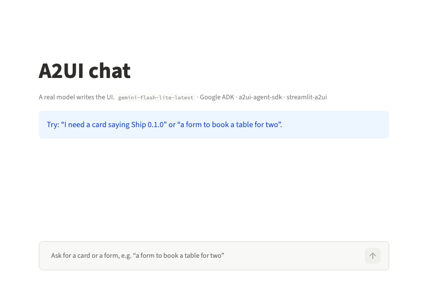

# streamlit-a2ui examples

Examples for [`streamlit-a2ui`](https://github.com/josechudev/streamlit-a2ui), which renders Google's A2UI 1.0 protocol in Streamlit. These need an API key and agent libraries that change fast, so they live here and not in the package repo.

## chat: a model writes the UI



Type "I need a card saying Ship 0.1.0" or "a form to book a table for two". A Google ADK agent (built with `a2ui-agent-sdk`) answers with A2UI 1.0 messages for the basic catalog; `streamlit_a2ui.a2ui_surface` renders them as real Streamlit components. Each assistant turn has its own surface and a collapsed expander with the A2UI JSON the agent sent (JSON in, components out). A button click in the card or form goes back to the agent, which updates the same surface.

How it fits together:

- `chat/agent.py`: ADK `LlmAgent` plus `a2ui-agent-sdk`. The renderer's capabilities (`renderer_capabilities()`) go through `read_renderer_capabilities(...)` so the agent knows the basic 1.0 catalog. The agent runs on its own thread and only appends to plain lists.
- `chat/app.py`: `st.chat_input`, and one `@st.fragment(run_every=0.5)` that redraws the conversation, so messages the agent thread appends appear while it is still answering. `a2ui_surface(log, key=...)` gets each turn's full append-only message list.

### Setup

Python 3.12 and a [Gemini API key](https://aistudio.google.com/apikey). Node is not needed: the `streamlit-a2ui` wheel ships the built frontend.

```bash
git clone https://github.com/josechudev/streamlit-a2ui-examples.git
cd streamlit-a2ui-examples
uv venv --python 3.12
uv pip install -r requirements.txt
cp .env.example .env   # then put your key after GOOGLE_API_KEY=
```

`.env` is git-ignored. Optional: `GEMINI_MODEL` (default `gemini-flash-lite-latest`).

```bash
uv run streamlit run chat/app.py
```

### Versions

Python 3.12, Streamlit 1.67.0, `streamlit-a2ui` 0.1.0, `google-adk` 2.14.1, `a2ui-agent-sdk` 0.12.0 (`a2ui-core` 0.7.0), `google-genai` 2.34.0. Pinned in `requirements.txt` (Streamlit comes with `streamlit-a2ui`).

### Which models worked

Gemini API key (not Vertex):

| Date | Model | Result |
|---|---|---|
| 2026-11-18 | `gemini-flash-lite-latest` | Card, booking form and the form's Send round trip all worked. Occasional `503 UNAVAILABLE` (high demand); the agent retries up to 3 times. |
| 2026-11-17 | `gemini-flash-latest`, `gemini-3.5` to `3.8-flash` | 503/504 under load. |
| 2026-11-17 | `gemini-pro-latest` | 429 (quota). |
| 2026-11-17 | `gemini-2.5-flash` | 404 (not available to new keys). |

Prompts that worked on 2026-11-18 with `gemini-flash-lite-latest`: "I need a card saying Ship 0.1.0" (a Card), "a form to book a table for two" (name, date, time and notes fields plus a button; Send reaches the agent and the surface turns into a confirmation).

### Known limits

- `a2ui_surface` returns at most one renderer message per rerun. Click a button twice quickly and one message is lost.
- The SDK rejects a re-sent `createSurface` ("Surface ... already exists"). The system prompt tells the model to update an existing surface with `surface("<id>", update=true)` (the SDK's Express form of `updateComponents`), and the action prompt repeats it. A model that ignores this shows a "rejected block" error in the chat; the renderer never sees the invalid message.
- The model sometimes writes validation `checks` with a key the renderer rejects (`@checks`), so the prompt forbids validation checks.
- Models vary by the hour (see the table). If the model is unavailable you get an error in the chat, not fake output.
- One agent session per browser session, kept in memory; reloading the page starts a new chat.

### Re-recording the GIF

With the app running on port 8599: `uv pip install playwright pillow && uv run playwright install chromium && uv run python scripts/record_demo.py`. It uses the real model, so it needs a key.

## License

Apache-2.0.
